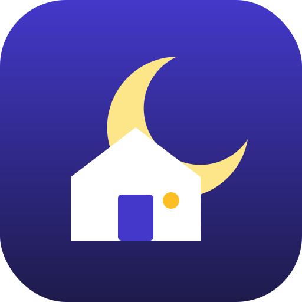

<p align="center"></p>

# Dark Outside for Homebridge

One sensor in Apple Home that turns on when it's actually dark outside.
It uses live sunlight data for your location from [Open-Meteo](https://open-meteo.com)
(free, no account or key). So it catches dull, stormy afternoons, not just sunset.

It shows as an **occupancy sensor**. Use it in Home app automations, for example:
"When Dark outside detects occupancy → porch light on, close the curtains."

## Install

In the Homebridge **Terminal**:

```
cd /var/lib/homebridge
npm install github:phevenAm/homebridge-dark-outside
```

## Settings

Add this to `platforms` in **JSON Config**, then restart:

```json
{
    "platform": "DarkOutside",
    "name": "Dark outside",
    "latitude": 51.44,
    "longitude": -0.89,
    "darkBelowLux": 300
}
```

To get your latitude and longitude: in Google Maps, right-click your house and click the numbers.

| Setting | What it does | Default |
| --- | --- | --- |
| `darkBelowLux` | Sensor turns on below this light level | 300 |
| `lightAboveLux` | Sensor turns off above this. Stops flicking on and off. | 1.5 x `darkBelowLux` |
| `refreshMinutes` | How often to fetch new data | 10 |

## Picking your number

The log shows the light level every 10 minutes, like `Light level: 820 lux (light)`.
Watch it on a gloomy day or at dusk, and set `darkBelowLux` to the level where you'd want the porch light on.

Rough guide: 10,000+ bright day · 1,000 very dull day · 300 heavy gloom or dusk · 50 nearly night.

## Notes

- The light level is worked out from forecast-model sunlight for your area, not a sensor at your window. It's a good guide, not exact.
- If it can't get data, it keeps its last state rather than guessing.
